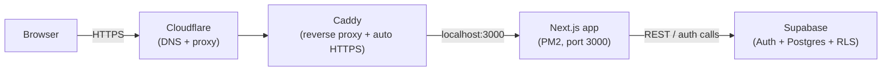
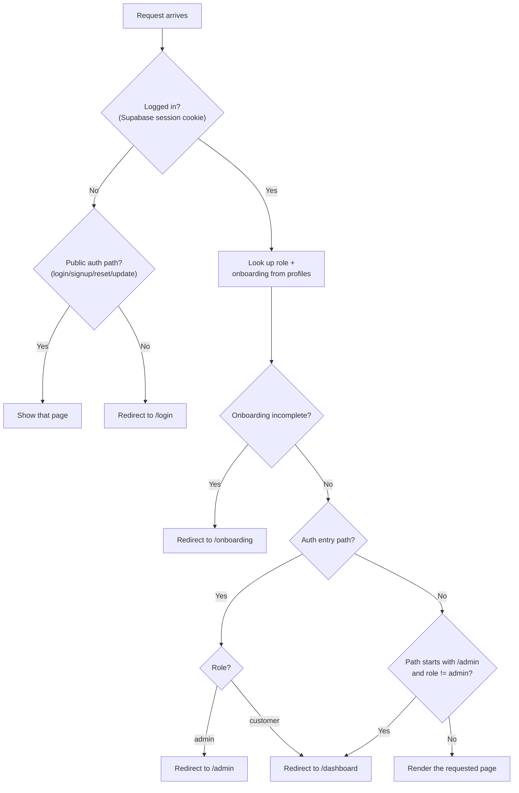

# TryEntitle Portal

Customer and admin portal for TryEntitle.

- **Live:** [tryentitle.tech/login](https://tryentitle.tech/login)
- **Stack:** Next.js 14 (App Router) · Supabase Auth + Postgres (RLS) · Sentry

## Who sees what

| Role | Home | Scope |
|------|------|--------|
| Admin | `/admin` | All customers, orders, products, messages, payouts, settings |
| Customer | `/dashboard` | Their own orders and help |

Access is checked in `middleware.ts` and enforced again by Postgres RLS. App checks are convenience; the database is the real boundary.

## Architecture



## Who can see what, step by step

Every request to auth routes (`/login`, `/signup`, `/reset-password`,
`/update-password`, `/onboarding`), `/admin/*`, or `/dashboard/*` passes through
`middleware.ts` first, before any page even starts rendering. This is where
the role check and redirect happen:



Once a page renders, it queries Supabase directly:

- Server components use `lib/supabase/server.ts`
- Client components (like the login form) use `lib/supabase/client.ts`

**Important:** the middleware check above is a convenience, not the real
security boundary. The real boundary is in Postgres. `supabase/schema.sql`
defines row-level security policies that apply no matter what the app code
does:

- `profiles`: a user can read their own row. Admins can read every row.
- `orders`: a customer can read rows where `customer_id = auth.uid()`.
  Admins can read every row.

So if a page's query ever forgot a `.eq('customer_id', ...)` filter, it
still couldn't leak another customer's data. The database would just
refuse to return those rows.

## Project layout

```
app/
  login/            public login form
  signup/           public email/password sign up
  reset-password/   request a password-reset email
  update-password/  set a new password from the email link
  onboarding/       first-login wizard (skippable)
  auth/callback/    exchanges Supabase email-link codes for a session
  admin/            admin-only: dashboard, customers, promote, help
  dashboard/        customer-only: their own orders, help
  page.tsx          root route, redirects to onboarding /admin /dashboard

components/
  AppShell.tsx      sidebar + header shell used by every authenticated page
  BarChart.tsx      order-volume chart (plain inline SVG, no chart library)
  DonutChart.tsx     order-status chart (plain inline SVG, no chart library)
  icons.tsx         hand-drawn icon set, no icon library dependency

lib/
  theme.ts          design tokens: the one place every color is defined
  nav.ts            sidebar nav structure, per role
  supabase/         client.ts (browser) and server.ts (server components)

middleware.ts        the role check described above

supabase/
  schema.sql         run this first, in a fresh Supabase project
  migrations/         run these next, in order
```

## Local development

```bash
npm install
cp .env.example .env.local   # Supabase URL, anon key, service role key
npm run dev
```

In the Supabase SQL editor:

1. Run `supabase/schema.sql`.
2. Run everything in `supabase/migrations/`, in order (including
   `008_freeze_profile_email.sql`, which blocks client rewrites of
   `profiles.email` so admin invites cannot be stolen via spoofed email, and
   `009_onboarding.sql`, which adds `profiles.onboarding_completed_at`).
3. Under **Authentication → URL Configuration**, add your site URL and
   redirect URLs for `/auth/callback` (used by signup confirm + password reset).
4. Create yourself a user under **Authentication → Users**. Check
   "Auto Confirm User".
5. Promote that user to admin:

```sql
update public.profiles set role = 'admin'
where id = (select id from auth.users where email = 'you@example.com');
```

Open [http://localhost:3000/login](http://localhost:3000/login).

## Project map

```
app/login          Sign in
app/admin          Analytics, orders, products, messages, customers, payouts, settings, help
app/dashboard      Customer orders + help
components/        UI (AppShell, charts, settings tabs, …)
lib/               theme, nav, analytics helpers, Supabase clients
supabase/          schema + migrations
deploy/            Caddy reverse-proxy config
```

## Env vars

See `.env.example`. Required:

- `NEXT_PUBLIC_SUPABASE_URL` / `NEXT_PUBLIC_SUPABASE_ANON_KEY`
- `SUPABASE_SERVICE_ROLE_KEY` (server-only; Team invites)

Optional: Sentry (`NEXT_PUBLIC_SENTRY_DSN`, `SENTRY_*`) for error reporting and source maps.

## Deploy

Self-managed VPS: PM2 runs Next.js, Caddy terminates HTTPS (`deploy/Caddyfile`).

```bash
cd ~/app && git pull && npm ci && npm run build && pm2 restart tryentitle
```

Vercel also works if the same env vars are set in the project settings — without them, `/login` will fail at runtime (and previously failed at build when the client was created during prerender).
