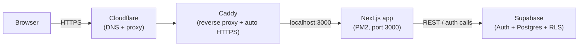
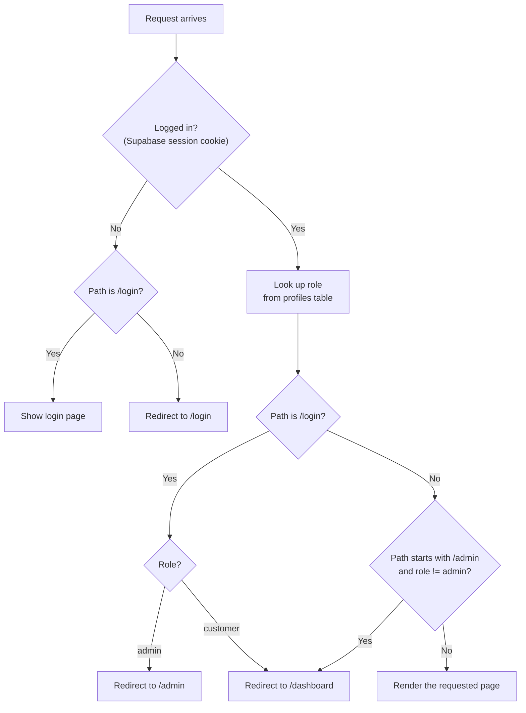

# TryEntitle Portal

Customer portal for TryEntitle: Next.js (App Router) + Supabase Auth, with
role-based routing and Postgres row-level security enforcing that every
customer only ever sees their own data — admins see everything.

Live at **https://tryentitle.tech/demo/login**.

## Architecture



Next.js runs under `basePath: '/demo'` (see `next.config.mjs`), so the whole
app lives at `/demo/*` rather than the domain root — this lets it sit
alongside a future marketing site on the same domain without conflicting.

## Request flow — who can see what

Every request to `/login`, `/admin/*`, or `/dashboard/*` passes through
`middleware.ts` before it reaches a page. That's where role-based routing
happens, *before* any page component runs:



The page itself then queries Supabase directly (via `lib/supabase/server.ts`
in server components, `lib/supabase/client.ts` in client components like the
login form). **Data isolation doesn't depend on the middleware check** — it's
enforced a second time, independently, by Postgres row-level security
policies in `supabase/schema.sql`:

- `profiles`: a user can read their own row; admins can read all rows
  (`is_admin()` helper function).
- `orders`: a customer can read rows where `customer_id = auth.uid()`;
  admins can read all rows.

So even a bug in a page's query (e.g. forgetting a `.eq('customer_id', ...)`
filter) can't leak another customer's data — the database itself refuses to
return rows the logged-in user isn't allowed to see.

## Project layout

```
app/
  login/            public login form
  admin/            admin-only: dashboard, customers, promote, help
  dashboard/        customer-only: their own orders, help
  page.tsx          root route — redirects to /admin or /dashboard by role
components/
  AppShell.tsx      sidebar + header shell used by every authenticated page
  BarChart.tsx, DonutChart.tsx   small inline-SVG charts, no chart library
  icons.tsx         hand-drawn icon set (no icon library dependency)
lib/
  theme.ts          design tokens (color scales) — the single source of
                     truth for colors used across every component
  nav.ts            sidebar nav structure per role
  supabase/         client.ts (browser) and server.ts (server components)
middleware.ts        the auth/role gate described above
supabase/
  schema.sql         run this first in a new Supabase project
  migrations/         run after schema.sql, in order
```

## Local development

```bash
npm install
cp .env.example .env.local   # fill in your Supabase project's URL + anon key
npm run dev
```

Then, in that Supabase project's SQL Editor: run `supabase/schema.sql`,
then everything in `supabase/migrations/` in order. Create yourself a user
under **Authentication → Users** (check "Auto Confirm User"), then promote
it to admin:

```sql
update public.profiles set role = 'admin'
where id = (select id from auth.users where email = 'you@example.com');
```

Visit `http://localhost:3000/demo/login`.

## Deployment

Deployed on a self-managed VPS: PM2 keeps the Next.js process alive and
restarts it on reboot; Caddy (`deploy/Caddyfile`) reverse-proxies and
auto-issues/renews the HTTPS certificate. A GitHub deploy key (read-only,
repo-scoped) is used to pull — no personal credentials live on the server.

To deploy an update:

```bash
cd ~/app && git pull && npm ci && npm run build && pm2 restart tryentitle
```
