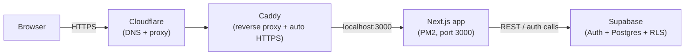
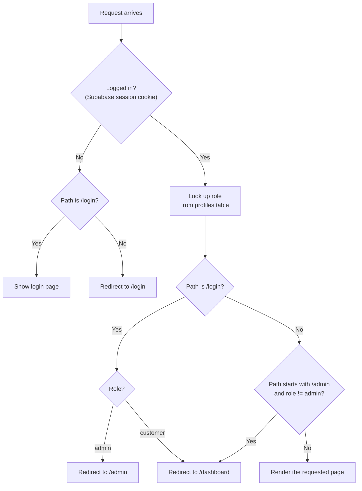

# TryEntitle Portal

Customer portal for TryEntitle. Built with Next.js (App Router) and
Supabase Auth.

Two roles, two views:

- **Admins** see every customer and every order.
- **Customers** see only their own data.

That separation is enforced twice: once by app routing, and once by the
database itself (Postgres row-level security). See below for how.

Live at **https://tryentitle.tech/demo/login**.

## Architecture



One thing to know: the app runs under `basePath: '/demo'` (see
`next.config.mjs`). So every route actually lives at `/demo/*`, not the
domain root. This leaves room for a marketing site at the root later,
without the two ever conflicting.

## Who can see what, step by step

Every request to `/login`, `/admin/*`, or `/dashboard/*` passes through
`middleware.ts` first, before any page even starts rendering. This is where
the role check and redirect happen:



Once a page renders, it queries Supabase directly:

- Server components use `lib/supabase/server.ts`
- Client components (like the login form) use `lib/supabase/client.ts`

**Important:** the middleware check above is a convenience, not the real
security boundary. The real boundary is in Postgres. `supabase/schema.sql`
defines row-level security policies that apply no matter what the app code
does:

- `profiles`: a user can read their own row. Admins can read every row.
- `orders`: a customer can read rows where `customer_id = auth.uid()`.
  Admins can read every row.

So if a page's query ever forgot a `.eq('customer_id', ...)` filter, it
still couldn't leak another customer's data. The database would just
refuse to return those rows.

## Project layout

```
app/
  login/            public login form
  admin/            admin-only: dashboard, customers, promote, help
  dashboard/        customer-only: their own orders, help
  page.tsx          root route, redirects to /admin or /dashboard by role

components/
  AppShell.tsx      sidebar + header shell used by every authenticated page
  BarChart.tsx      order-volume chart (plain inline SVG, no chart library)
  DonutChart.tsx     order-status chart (plain inline SVG, no chart library)
  icons.tsx         hand-drawn icon set, no icon library dependency

lib/
  theme.ts          design tokens: the one place every color is defined
  nav.ts            sidebar nav structure, per role
  supabase/         client.ts (browser) and server.ts (server components)

middleware.ts        the role check described above

supabase/
  schema.sql         run this first, in a fresh Supabase project
  migrations/         run these next, in order
```

## Local development

```bash
npm install
cp .env.example .env.local   # fill in your Supabase project's URL + anon key
npm run dev
```

Then, in that Supabase project's SQL Editor:

1. Run `supabase/schema.sql`.
2. Run everything in `supabase/migrations/`, in order.
3. Create yourself a user under **Authentication → Users**. Check
   "Auto Confirm User".
4. Promote that user to admin:

```sql
update public.profiles set role = 'admin'
where id = (select id from auth.users where email = 'you@example.com');
```

Visit `http://localhost:3000/demo/login`.

## Deployment

Runs on a self-managed VPS:

- **PM2** keeps the Next.js process alive and restarts it on reboot.
- **Caddy** (`deploy/Caddyfile`) reverse-proxies to it and auto-issues and
  renews the HTTPS certificate.
- A **GitHub deploy key** (read-only, scoped to this repo) is what the
  server uses to pull. No personal credentials live on the server.

To ship an update:

```bash
cd ~/app && git pull && npm ci && npm run build && pm2 restart tryentitle
```
